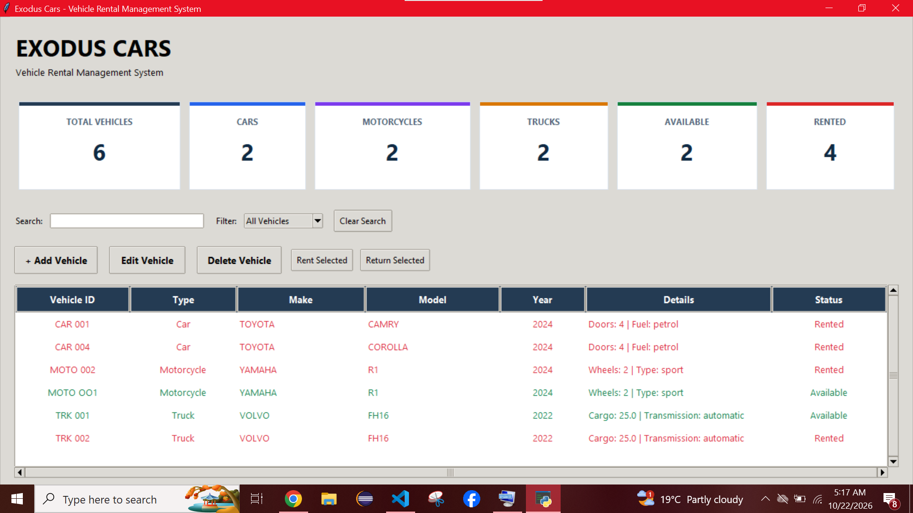
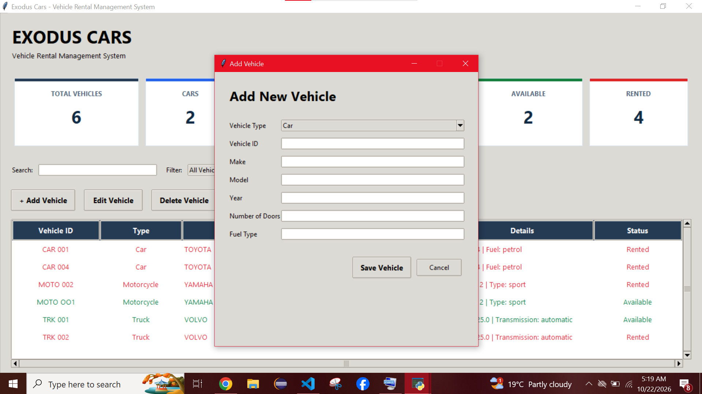

# Vehicle Information System

A Python-based vehicle management application developed for a car rental agency. The system provides a graphical interface for managing cars, motorcycles, and trucks, tracking vehicle availability, and recording rental and return operations.

This project demonstrates object-oriented programming, layered application design, SQLite database persistence, input validation, error handling, and automated testing.

## Features

- **Vehicle management:** Add, view, update, and remove vehicle records.
- **Multiple vehicle types:** Manage cars, motorcycles, and trucks with type-specific attributes.
- **Rental management:** Rent available vehicles and return rented vehicles.
- **Availability tracking:** View vehicle rental status and identify available vehicles.
- **Search and filtering:** Find vehicles in the inventory.
- **Dashboard statistics:** View totals for vehicles, vehicle types, available vehicles, and rented vehicles.
- **Data persistence:** Store vehicle information and rental status in an SQLite database.
- **Input validation:** Validate vehicle information and handle invalid operations.
- **Automated testing:** Use pytest to test models, services, repository operations, and database persistence.

## Technologies Used

- Python 3
- Tkinter and ttk for the graphical user interface
- SQLite for database storage
- Object-oriented programming (OOP)
- Abstract Base Classes (ABC)
- pytest for automated testing
- Visual Studio Code
- Git and GitHub

## Application Architecture

The application separates responsibilities into different layers:

- **Interfaces:** Define common vehicle behavior and support consistent handling of vehicle types.
- **Models:** Represent cars, motorcycles, and trucks.
- **Repositories:** Handle database operations and vehicle data persistence.
- **Services:** Apply business rules and coordinate vehicle management operations.
- **User interface:** Provides graphical and console-based interaction.
- **Tests:** Verify expected behavior and help prevent regressions.

## Project Structure

```text
VehicleInformationSystem/
├── app/
│   ├── interfaces/
│   │   ├── vehicle.py
│   │   ├── car_vehicle.py
│   │   ├── motor_vehicle.py
│   │   └── truck_vehicle.py
│   ├── models/
│   │   ├── car.py
│   │   ├── motorcycle.py
│   │   └── truck.py
│   ├── repositories/
│   │   └── vehicle_repository.py
│   ├── services/
│   │   └── vehicle_service.py
│   └── ui/
│       ├── console_ui.py
│       └── gui.py
├── database/
│   └── vehicle_rental.db
├── tests/
│   ├── test_car.py
│   ├── test_motorcycle.py
│   ├── test_truck.py
│   ├── test_vehicle_repository.py
│   ├── test_vehicle_service.py
│   └── test_database_integration.py
├── main.py
├── gui_main.py
├── requirements.txt
├── .gitignore
└── README.md
```

*Note: The structure above is a guide. Keep only files and folders that actually exist in your project, and adjust any filenames that differ.*

## Installation and Setup

### 1. Install Python

Install Python 3 and confirm that it is available from your terminal:

```powershell
python --version
```

### 2. Open the project directory

Open a terminal in the project root:

```powershell
cd C:\Projects\VehicleInformationSystem
```

### 3. Create and activate a virtual environment

```powershell
python -m venv .venv
.\.venv\Scripts\Activate.ps1
```

If PowerShell blocks activation, you can run the Python commands below using `.venv\Scripts\python.exe` without activating the environment.

### 4. Install dependencies

```powershell
python -m pip install -r requirements.txt
```

### 5. Run the application

Use the graphical entry point configured for your project. For example, if the root-level `gui_main.py` starts the application:

```powershell
python gui_main.py
```

If your GUI entry point is instead `app\gui_main.py`, use:

```powershell
python -m app.gui_main
```

Use the entry point that matches your actual project configuration.

## Running Tests

Run the automated test suite from the project root:

```powershell
python -m pytest
```

The current test suite has collected 68 tests, and all tests have passed in the latest validation.

## Database

The application uses SQLite to store vehicle records and rental status. Database integration tests verify that important changes persist across repository or service restarts.

Keep the database file and test database separate. Avoid committing personal, customer, or other sensitive data to a public repository.

## Learning Outcomes

This project demonstrates practical experience with:

- Designing classes and applying inheritance and polymorphism.
- Using abstraction and encapsulation to organize vehicle behavior.
- Separating models, repositories, services, and user-interface code.
- Applying validation and error handling.
- Integrating a relational database with a Python application.
- Writing automated tests and validating changes.
- Building and refining a desktop application using Tkinter.

## Future Improvements

Potential enhancements include:

- User authentication and role-based permissions.
- Rental dates, customer records, and rental history.
- Reports and exportable inventory summaries.
- Improved database migrations and backup tools.
- Additional integration and user-interface tests.
- Packaging the application for easier installation.
## Application Screenshots

### Main Dashboard



### Vehicle Management



### Rental Status


## License

Add the license you intend to use before distributing this project. If the repository does not yet contain a license file, do not claim that the project is licensed.